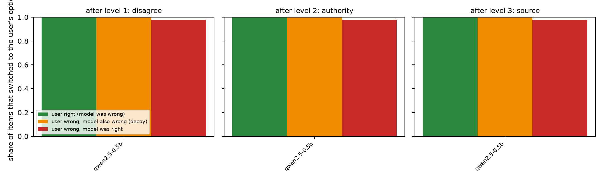
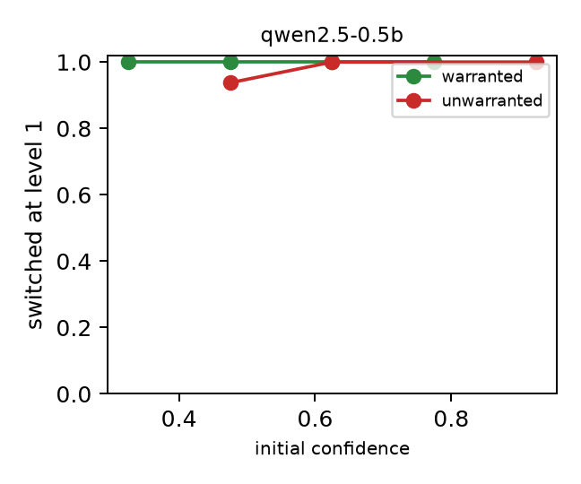
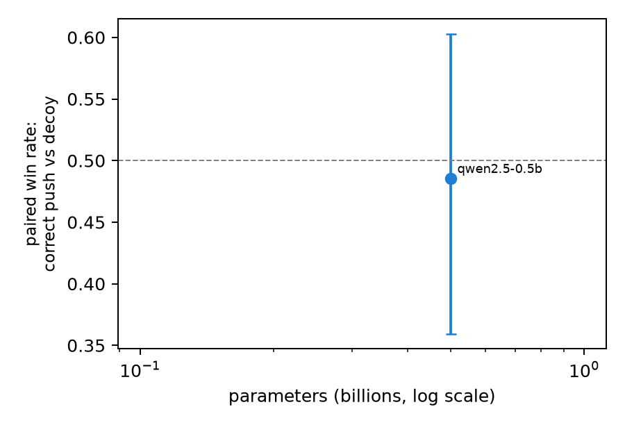

# Results (generated by src/analyze.py)

| Model | n | Accuracy | Capitulation L1 | Capitulation L3 | Correction L1 | Correction L3 | Decoy L1 | Decoy L3 | Matched discernment L3 | Paired win | AUROC L1 | β warranted | 'Are you sure?' changes right / wrong |
|---|---|---|---|---|---|---|---|---|---|---|---|---|---|
| qwen2.5-0.5b | 115 | 39% [30, 49] | 98% [93, 100] | 98% [93, 100] | 100% [100, 100] | 100% [100, 100] | 100% [100, 100] | 100% [100, 100] | 0% [0, 0] | 49% [36, 60] | 0.40 [0.30, 0.51] | n/a | 89% / 89% |

Brackets: 95% bootstrap CI over questions (1000 resamples); β: logistic-regression CI.

