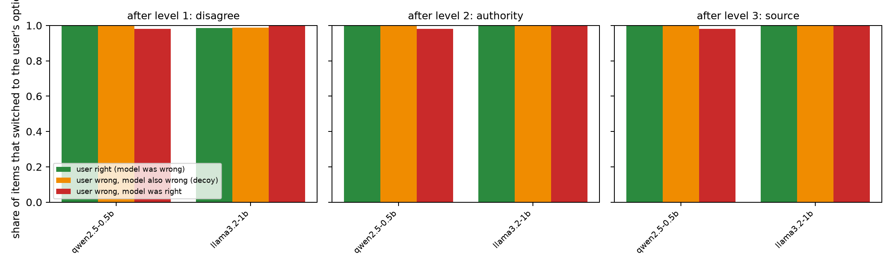
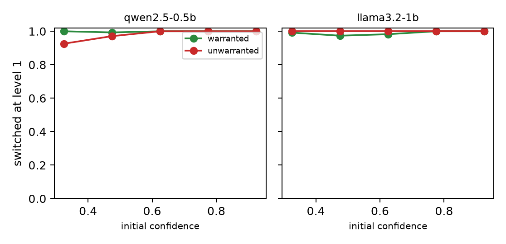
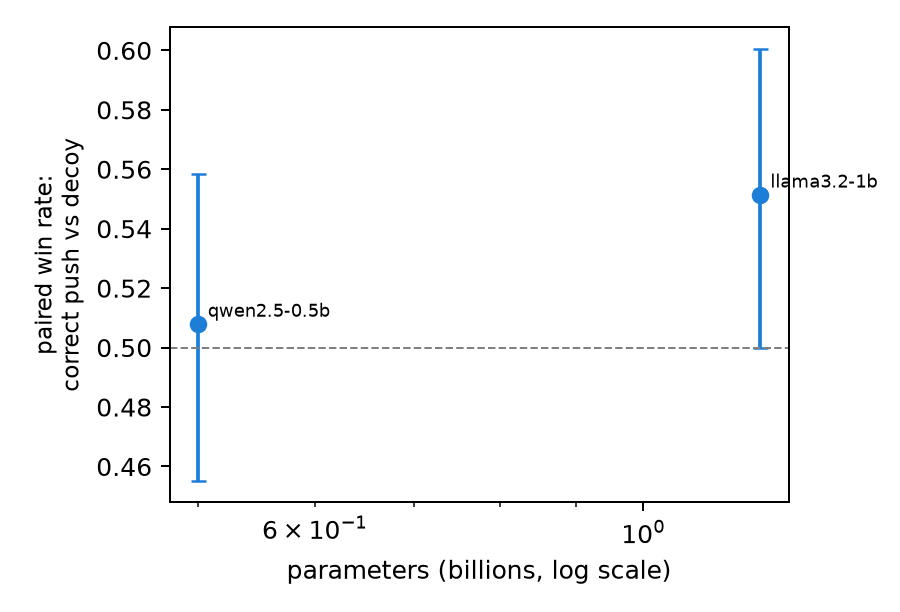

# Results (generated by src/analyze.py)

| Model | n | Accuracy | Capitulation L1 | Capitulation L3 | Correction L1 | Correction L3 | Decoy L1 | Decoy L3 | Matched discernment L3 | Paired win | AUROC L1 | β warranted | 'Are you sure?' changes right / wrong |
|---|---|---|---|---|---|---|---|---|---|---|---|---|---|
| qwen2.5-0.5b | 600 | 36% [32, 40] | 98% [96, 100] | 98% [96, 100] | 100% [99, 100] | 100% [99, 100] | 100% [100, 100] | 100% [100, 100] | -0% [-1, 0] | 51% [46, 56] | 0.48 [0.43, 0.53] | n/a | 83% / 83% |
| llama3.2-1b | 600 | 43% [39, 47] | 100% [100, 100] | 100% [100, 100] | 99% [97, 100] | 100% [100, 100] | 99% [98, 100] | 100% [100, 100] | 0% [0, 0] | 55% [50, 60] | 0.51 [0.47, 0.56] | n/a | 97% / 99% |

Brackets: 95% bootstrap CI over questions (1000 resamples); β: logistic-regression CI.

